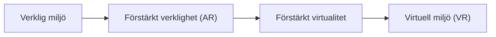

# Kapitel 1: Verkligheter att designa för

> **I det här kapitlet lär du dig**
> - skillnaden mellan virtuell verklighet, förstärkt verklighet och blandad verklighet
> - vad immersion och närvaro betyder och varför de styr designen
> - hur ett headset vet var du är och åt vilket håll du tittar
> - vad en tjänst utformad efter geografisk kontext är

Ta på dig ett VR-headset och rummet försvinner. Du står på en bowlingbana, och när du böjer dig ner för att ta klotet rör sig världen precis som den skulle göra på riktigt. Det finns ingen knapp som heter "böj dig". Din kropp är gränssnittet.

Det är kursens stora idé. Ett gränssnitt är allt det som står mellan en människa och ett system: knappar, text, ljud, vibrationer, och i 3D även rummet självt. När gränssnittet flyttar från skärmen ut i rummet ändras reglerna för hur det måste utformas.

## Från verklighet till virtuell värld

Forskarna Paul Milgram och Fumio Kishino beskrev 1994 ett **verklighet–virtualitets-kontinuum**. Tanken är att verkligt och virtuellt inte är två lådor utan ändarna på en skala.

| Begrepp | Vad du ser | Typiskt exempel |
|---|---|---|
| **VR**, virtuell verklighet | En helt datorgenererad värld. Den verkliga omgivningen är utestängd. | Ett sportspel i ett headset |
| **AR**, förstärkt verklighet | Den verkliga världen med digitalt innehåll ovanpå. | En mobilapp som ställer en möbel på ditt golv |
| **MR**, blandad verklighet | Digitalt innehåll som tar hänsyn till det verkliga rummet, till exempel bakom din soffa. | Ett headset som låter en virtuell boll studsa mot din riktiga vägg |
| **XR**, utökad verklighet | Samlingsnamn för allt ovanstående. | "XR Interaction Toolkit" i Unity |

Gränserna är flytande. Meta Quest 3, det headset som VR-projektet i kursen använder, kan både stänga ute rummet och visa det genom sina kameror. Den tekniken kallas **passthrough** och gör att samma apparat kan ge både VR och MR.

### Genomgånget exempel: placera in produkter

Så här kan du resonera när du ska avgöra vad något är. Fråga dig två saker: *Ser användaren den verkliga världen?* och *Tar det digitala hänsyn till den?*

| Produkt | Ser verkligheten? | Tar hänsyn till den? | Slutsats |
|---|---|---|---|
| Bowlingspel i headset utan passthrough | Nej | Nej | VR |
| Filter i mobilen som sätter solglasögon på ansiktet | Ja | Ja, följer ansiktet | AR |
| Poängtavla som bara svävar i synfältet i passthrough | Ja | Nej | AR i enkel form |
| Virtuell boll som studsar mot rummets väggar i passthrough | Ja | Ja, känner till väggarna | MR |

Märk att svaret beror på vad produkten faktiskt gör, inte vilken apparat den körs på.

## Immersion och närvaro

Två ord används ofta som om de betydde samma sak, men de gör det inte.

**Immersion** handlar om tekniken: hur stor del av dina sinnen systemet täcker och hur väl det gör det. Brett synfält, hög bildfrekvens och riktat ljud ger högre immersion.

**Närvaro** handlar om upplevelsen: känslan av att faktiskt vara på platsen. Den är personlig och går sönder lätt. En hand som hoppar, en dörr som inte går att öppna eller en boll som glider genom golvet räcker för att påminna dig om att allt är påhittat.

För dig som designer betyder det att konsekvens ofta är viktigare än snygg grafik. En enkel värld som beter sig pålitligt känns mer verklig än en vacker värld som beter sig konstigt.

## Hur headsetet vet var du är

**Spårning** (tracking) betyder att systemet mäter hur du rör dig. Man brukar räkna **frihetsgrader**, på engelska *degrees of freedom*, förkortat DoF.

| Typ | Vad som mäts | Vad det betyder |
|---|---|---|
| 3DoF | Rotation runt tre axlar | Du kan vända huvudet, men inte luta dig fram eller gå |
| 6DoF | Rotation och förflyttning längs tre axlar | Du kan också gå, huka och sträcka dig |

Moderna fristående headset som Quest 3 har 6DoF för både huvud och handkontroller. De använder kameror och rörelsesensorer för att följa huvud och händer i förhållande till rummet. Det kallas **inside-out-spårning**, eftersom sensorerna sitter på headsetet och tittar ut.

## Tjänster som vet var du är

Skolverkets innehåll tar också upp **tjänster utformade efter geografisk kontext**. Det är tjänster som ändrar sitt innehåll beroende på var användaren befinner sig: en karta som visar närmaste busshållplats, en vädertjänst som visar din stad, ett AR-spel som Pokémon Go där platser i verkligheten blir en del av spelet.

Några begrepp att känna till:

- **Satellitpositionering** (till exempel GPS) ger en position utomhus, ofta med några meters noggrannhet under öppen himmel. Inomhus fungerar det sämre.
- **Geofence** är en virtuell gräns på kartan. När användaren passerar den händer något, till exempel att en påminnelse visas.
- **Rumslig kontext** är allt som omger användaren: plats, tid, riktning och vad som finns i närheten.

Tjänster som vet var du är kan vara väldigt hjälpsamma, men platsdata avslöjar också mycket om en människa. Det återkommer vi till i [kapitel 10](10-vardagsdatorer-etik-och-lagar.md).

## Spetsteknik har en livscykel

VR kan se nytt ut, men idén är gammal. Redan 1968 byggde datavetaren Ivan Sutherland ett huvudburet system som visade enkel datorgrafik, och det hängde från taket eftersom det var så tungt. Sedan dess har tekniken gått i vågor av stort intresse, besvikelse och nya genombrott.

Det här mönstret är värt att känna till. En teknik föds i forskningen, blir dyr specialutrustning, sprids till fler och blir till slut vardag eller ersätts av något annat. När du väljer teknik för ett projekt behöver du fråga var på den kurvan den befinner sig. Finns verktygen om några år? Finns det folk som kan underhålla lösningen?

## Var används det?

Spel är det mest kända området, men långt ifrån det enda. VR används för att träna på sådant som är farligt eller dyrt att öva på i verkligheten, till exempel att hantera maskiner. AR kan visa instruktioner direkt på en apparat som ska repareras. Arkitekter kan låta kunder gå runt i en byggnad som ännu inte finns.

Gemensamt för de här exemplen är att 3D ger något som en vanlig skärm inte kan ge. Det är en bra fråga att ställa om din egen idé: **vad vinner användaren på att detta är i 3D?** Är svaret "ingenting" är en vanlig app kanske bättre.

## Begrepp

- **Gränssnitt:** allt som står mellan en människa och ett system, och som gör att de kan påverka varandra.
- **VR:** datorgenererad värld som ersätter den verkliga omgivningen.
- **AR:** digitalt innehåll som läggs ovanpå den verkliga världen.
- **MR:** digitalt innehåll som tar hänsyn till det verkliga rummet.
- **XR:** samlingsnamn för VR, AR och MR.
- **Passthrough:** headsetet visar omvärlden med hjälp av kameror.
- **Immersion:** hur väl tekniken omsluter sinnena.
- **Närvaro:** känslan av att vara på platsen.
- **DoF:** frihetsgrader, antal sätt spårningen kan mäta rörelse.
- **Geofence:** virtuell geografisk gräns som utlöser något.

## Koppling till projektet

[VR/AR - Projekt](../projekt/vr-ar/README.md) börjar med en introduktion till just de här begreppen. När du väljer sport, fundera på vad VR ger just den sporten. Kapitlets avsnitt om livscykler är också bakgrund till [Spetsteknikens livscykel](../projekt/spetsteknikens-livscykel/README.md).

## Läs mer

- [Reality–virtuality continuum på Wikipedia](https://en.wikipedia.org/wiki/Reality%E2%80%93virtuality_continuum)
- [Förstärkt verklighet på svenska Wikipedia](https://sv.wikipedia.org/wiki/F%C3%B6rst%C3%A4rkt_verklighet)
- [The Sword of Damocles på Wikipedia](https://en.wikipedia.org/wiki/The_Sword_of_Damocles_%28virtual_reality%29)
- [3D-AR-VR-Interface-Design](https://github.com/abbjetmus/3D-AR-VR-Interface-Design), avsnittet om 3D, AR och VR

[Innehåll](../README.md) | [Nästa →](02-verktyg-for-3d.md)
