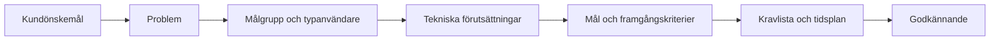

# Kapitel 3: Förstudie och projektplan

> **I det här kapitlet lär du dig**
> - hur du gör en problemformulering utifrån kundönskemål
> - hur du beskriver en målgrupp och en typanvändare
> - hur du undersöker tekniska förutsättningar och skriver mätbara mål
> - hur datorstöd håller ihop ett projekt

De flesta projekt som misslyckas gör det inte på grund av dålig kod. De misslyckas för att ingen tog reda på vad som egentligen skulle byggas, eller för att gruppen försökte göra allt samtidigt. En **förstudie** är arbetet du gör innan du bygger, för att ta reda på vad som ska göras, för vem och om det går.

## Från önskemål till problem

En **beställare** är den som vill ha något byggt. I arbetslivet är det ofta en kund, och i kursens projekt är det läraren som godkänner din plan och därmed fungerar närmast som beställare.

Kunder berättar ofta vilken lösning de tror att de vill ha. Ditt jobb är att hitta problemet bakom önskemålet.

| Kundönskemål | Problemet bakom |
|---|---|
| "Vi vill ha en VR-app" | Nyanställda behöver träna på en maskin utan att riskera olyckor |
| "Vi vill ha en större knapp" | Användarna hittar inte hur de börjar |
| "Vi vill ha ett coolt spel" | Besökare på en mässa ska stanna längre och förstå produkten på en minut |

En **problemformulering** beskriver vem som har problemet, vad problemet är och varför det spelar roll. En bra formulering säger inget om lösningen.

## Målgrupp och typanvändare

En **målgrupp** är de människor som produkten är till för. "Alla" är inte en målgrupp, för då kan du aldrig avgöra vad som är bra design.

En **typanvändare**, även kallad persona, är en påhittad men trovärdig person som representerar målgruppen. Den gör det lättare att diskutera: "Skulle Sara förstå den här menyn?" fungerar bättre än "Skulle användaren förstå den här menyn?". Skriv sådant som påverkar designen, som vana vid tekniken, syfte, och begränsningar. Skriv inte sådant som inte spelar någon roll, som favoritfärg.

## Tekniska förutsättningar

Innan du lovar något måste du veta vad som går. Undersök:

- **Plattform:** vilken hårdvara ska spelet köras på? Fristående headset har mindre beräkningskraft än en stationär dator.
- **Verktyg:** vilken motor, vilka paket och vilken version?
- **Inmatning:** handkontroller, tangentbord, mus, handspårning?
- **Tillgång:** när kan ni faktiskt testa i headset?
- **Kunskap:** vad behöver ni lära er, och hinner ni det?

## Mål och framgångskriterier

En **målsättning** beskriver vad projektet ska åstadkomma. Ett **framgångskriterium** beskriver hur du vet att det har lyckats. Skillnaden är att kriteriet går att mäta.

| Vagt mål | Mätbart framgångskriterium |
|---|---|
| Spelet ska vara lätt att förstå | 4 av 5 testare kan starta spelet och kasta första klotet utan hjälp |
| Spelet ska vara snabbt | Bildfrekvensen ligger stabilt på minst 72 FPS på en Quest 3 |
| Menyn ska vara tydlig | Testaren hittar omstart på under 10 sekunder |

## Genomgånget exempel: förstudie till ett bowlingspel

1. **Kundönskemål:** "Vi vill ha ett VR-spel om sport."
2. **Problemformulering:** Elever som aldrig provat VR behöver en kort och tydlig upplevelse där de på några minuter kan förstå hur man greppar och kastar.
3. **Målgrupp:** ungdomar med liten VR-vana.
4. **Typanvändare:** Noor, 17 år, spelar på mobilen men har aldrig haft headset på sig. Hon vill inte se dum ut inför andra och tappar intresset om hon inte förstår direkt.
5. **Tekniska förutsättningar:** Unity 6, XR Interaction Toolkit 3.x, Meta Quest 3, bygge som `.apk`.
6. **Framgångskriterier:** Noor ska kunna kasta inom en minut utan muntliga instruktioner, och spelet ska hålla minst 72 FPS.

Sedan delar du upp funktionerna i **måste** och **om vi hinner**. En omstart och en poängtavla är måste, medan flera banor är något du gör om tid finns över. Kursens [planeringsmall](https://github.com/abbjetmus/Virtual-Reality/blob/main/PLANERING.md) följer samma logik.

## Risker: räkna på vad som kan gå fel

En enkel metod är att ge varje risk två tal mellan 1 och 5: **sannolikhet** och **konsekvens**. Multiplicera dem så får du ett riskvärde. Då ser du vad du ska ta hand om först.

| Risk | Sannolikhet | Konsekvens | Riskvärde | Plan B |
|---|---|---|---|---|
| Kastet känns fel i VR | 3 | 4 | 12 | Testa kastet tidigt och justera värden |
| Bygget till headset fungerar inte i slutet | 2 | 5 | 10 | Bygg en `.apk` tidigt och ofta |
| Musiken hinner inte bli klar | 4 | 2 | 8 | Använd licensfri musik |

Risken med högst värde hanteras först. Att bygget inte fungerar har lägre sannolikhet, men om det händer sista dagen är det förödande. Det är därför lektionsplanen i VR-projektet lägger ett första `.apk`-bygge före användartestet.

## Datorstöd för projekthantering

Ett projekt med flera personer behöver gemensamma verktyg. Kursens projekt använder Git och GitHub.

| Verktyg | Vad det löser |
|---|---|
| **Git** | Versionshantering: varje ändring sparas och kan återställas |
| **Branch** | Egen arbetskopia, så att du inte förstör för andra |
| **Pull request** | Förslag om att föra in en ändring, som andra kan granska |
| **Git LFS** | Hanterar stora filer som modeller och ljud |
| **GitHub Issues och Projects** | Uppgifter och tavla som visar vem som gör vad |
| **Tidsplan** | Vad som ska vara klart när, ofta en tabell |

En **uppgiftstavla** med kolumnerna *Att göra*, *Pågår* och *Klart* räcker långt. Det viktiga är att alla uppdaterar den, annars visar den snart fel.

## Värdera din plan

Betygskriterierna handlar också om hur du **värderar** din projektplan. Det betyder att du tänker kritiskt om den, inte bara beskriver den. Frågor du kan ställa:

- Är problemet verkligen ett problem för målgruppen?
- Hinner vi? Vad säger tiden som hittills gått?
- Vilka mål var svåra att mäta, och varför?
- Vad i planen var fel, och vad skulle vi ändra?

## Begrepp

- **Förstudie:** arbetet som görs före bygget för att ta reda på vad som ska göras.
- **Beställare:** den som vill ha något byggt.
- **Problemformulering:** beskrivning av vem som har vilket problem och varför det spelar roll.
- **Målgrupp:** de människor produkten är till för.
- **Typanvändare (persona):** påhittad person som representerar målgruppen.
- **Framgångskriterium:** mätbart sätt att avgöra om målet är nått.
- **Riskvärde:** sannolikhet multiplicerat med konsekvens.

## Koppling till projektet

I [VR/AR - Projekt](../projekt/vr-ar/README.md) fyller ni i planeringsmallen och lämnar in den innan ni bygger spelet. I [3D-Spel](../projekt/3d-spel/README.md) skriver du en egen projektplan med spelidé, målgrupp, skisser, kravlista och tekniska förutsättningar.

## Läs mer

- [Planeringsmall för VR-sportspelet](https://github.com/abbjetmus/Virtual-Reality/blob/main/PLANERING.md)
- [GitHub: Planning and tracking with Projects](https://docs.github.com/en/issues/planning-and-tracking-with-projects)
- [GitHub: About Git Large File Storage](https://docs.github.com/en/repositories/working-with-files/managing-large-files/about-git-large-file-storage)

[← Föregående](02-verktyg-for-3d.md) | [Innehåll](../README.md) | [Nästa →](04-navigation-och-forflyttning.md)
