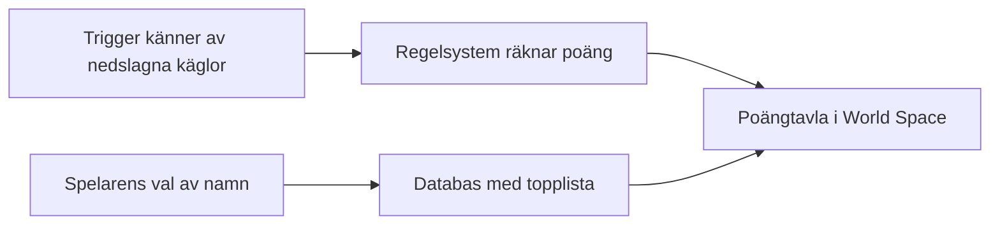

# Kapitel 7: Text, ljud och datakällor

> **I det här kapitlet lär du dig**
> - hur text och menyer fungerar i en 3D-miljö
> - hur du räknar på om text går att läsa på avstånd
> - hur ljud och vibration kan ge information
> - vilka datakällor som kan ge användaren information

Du står i en bowlinghall i VR och kastar ett strike. Vad säger dig att det gick bra? Käglorna som faller, smällen, publiken som jublar, vibrationen i handen och poängtavlan som uppdateras. Fem olika kanaler berättar samma sak, och det är just samspelet mellan dem som gör att det känns rätt.

## Var ska gränssnittet finnas?

På en skärm ligger menyn ovanpå bilden. I 3D finns fler möjligheter.

| Typ | Var den finns | Exempel | Passar i VR? |
|---|---|---|---|
| **Del av världen** | Ett föremål i scenen, som även figuren skulle se | Poängtavla på väggen | Ja, oftast bäst |
| **Rumsligt fäst** | Ett föremål i scenen utan motsvarighet i verkligheten | Svävande pil över målet | Ja |
| **Ovanpå bilden** (HUD) | Fast i synfältet | Hälsobar i hörnet | Dåligt i VR, bra på skärm |

**HUD** står för *heads-up display*. I ett vanligt spel fungerar det utmärkt, men i ett headset följer en HUD med huvudet. Det känns som att ha ett klistermärke på glasögonen och gör det svårt att fokusera.

### Så gör du i Unity

En vanlig Canvas i Screen Space fungerar inte i VR. Sätt **Render Mode** till **World Space** och placera den som ett föremål i världen. Lägg till komponenten **Tracked Device Graphic Raycaster** så att handkontrollernas strålar kan träffa knapparna.

### Så gör du i Godot

Ett vanligt 3D-spel använder en `CanvasLayer` med `Control`-noder ovanpå bilden. Så här kan ett skript för poängen se ut:

```gdscript
extends CanvasLayer

@onready var score_label: Label = $ScoreLabel

func update_score(score: int) -> void:
    score_label.text = "Poäng: %d" % score
```

Skriptet förutsätter en `Label` som barn med namnet `ScoreLabel`.

## Läsbar text

Hur stor en text upplevs beror inte bara på storleken utan också på hur långt bort den är. Det mäter man med **synvinkel**, vinkeln som texten upptar i synfältet.

### Genomräknat exempel: poängtavla på väggen

En bokstav är `h` meter hög och ligger `d` meter bort. Synvinkeln är:

```
vinkel = 2 × arctan(h / (2 × d))
```

| Bokstavshöjd | Avstånd | Synvinkel |
|---|---|---|
| 2 cm | 1 m | 1,15° |
| 2 cm | 3 m | 0,38° |
| 6 cm | 3 m | 1,15° |

Om tavlan flyttas tre gånger längre bort måste bokstäverna bli tre gånger högre för att se lika stora ut. Vilken vinkel som faktiskt går att läsa beror på headset, typsnitt och kontrast, så testa alltid i headsetet. Använd också ett tydligt typsnitt utan tunna streck, och ha mörk bakgrund bakom texten om miljön är rörig.

## Bild, film och ljud måste anpassas

Filer behöver anpassas efter gränssnittet. En film som ska spelas på en vägg i en VR-scen behöver inte vara i högsta upplösning, men den ska hålla bildfrekvensen. En ikon ska vara tydlig även på avstånd. Komprimera ljud och bild, och välj format som motorn hanterar väl.

## Ljud som information

Ljud är ofta det snabbaste sättet att ge återkoppling, eftersom hörseln inte behöver riktas åt rätt håll.

| Typ av ljud | Uppgift | Exempel |
|---|---|---|
| Effektljud | Bekräftar att något hände | Klicket när bollen träffas |
| Spatialt ljud | Berättar var något är | Ett mål som låter från vänster |
| Bakgrundsljud | Skapar stämning | Publik, vind |
| Musik | Styr känsla och tempo | Lugn musik i menyn |

**Spatialt ljud** placerar ljudet i rummet. I Unity sätter du **Spatial Blend** på en `AudioSource` till 3D, och i Godot använder du `AudioStreamPlayer3D`. I VR är det extra viktigt, eftersom ljudet hjälper spelaren att vända sig mot rätt håll.

**Haptisk återkoppling** betyder att du känner något, oftast en vibration i handkontrollen. Du kan göra det med `SendHapticImpulse`. Se exemplet `Vibration` i [Virtual-Reality](https://github.com/abbjetmus/Virtual-Reality).

En viktig tumregel: **ge samma information på flera sätt.** Om spelaren inte hör ljudet måste det ändå synas något. Det är bra både för tillgängligheten och för hur tydligt spelet känns.

## Datakällor

Ett gränssnitt visar information, och den informationen kommer alltid någonstans ifrån. En **datakälla** är var uppgifterna hämtas.

| Datakälla | Exempel på uppgifter | Att tänka på |
|---|---|---|
| Spelets eget tillstånd | Poäng, tid, antal liv | Pålitlig, finns alltid |
| Sensorer i headset och kontroller | Var huvud och händer är, kameror | Kan tappa spårning, är känsliga uppgifter |
| Satellitpositionering | Var användaren är | Osäker inomhus, integritetskänslig |
| Webbtjänster (API) | Väder, kartor, kollektivtrafik | Kräver internet, kan vara nere eller försenade |
| Databaser | Topplistor, användarprofiler | Måste skyddas, kräver underhåll |
| Användaren själv | Namn, val, inställningar | Fråga bara om det du behöver |
| Andra spelare | Position, röst | Kräver nätverk, risk för missbruk |

När du väljer datakälla, ställ de här frågorna: Är uppgifterna **korrekta**? Är de **aktuella**? Vad händer om de **saknas**? Är de **känsliga**? Ett bra gränssnitt visar till exempel "Ingen kontakt med servern" i stället för ett gammalt väder som ser aktuellt ut.

### Genomgånget exempel: datakällor till en poängtavla

Tänk på en bowlingtavla i World Space. Vad behöver den visa, och var kommer det ifrån?



1. Antal nedslagna käglor kommer från spelets egen fysik och triggers.
2. Poängen räknas ut av regelsystemet.
3. En topplista kräver en databas, antingen lokalt i headsetet eller på en server. Sparas den på en server behöver du fundera på om spelarens namn är en personuppgift.

Ju mer data du hämtar utifrån, desto mer kan gå fel. Det är ett skäl att börja enkelt.

## Begrepp

- **HUD:** information som ligger ovanpå bilden.
- **World Space:** gränssnitt som är placerat som ett föremål i världen.
- **Synvinkel:** vinkeln ett föremål upptar i synfältet.
- **Spatialt ljud:** ljud som är placerat i rummet.
- **Haptisk återkoppling:** information via känseln.
- **Datakälla:** var uppgifterna till gränssnittet kommer ifrån.
- **API:** gränssnitt mellan program, ofta för att hämta data över nätet.

## Testa dig själv

1. Varför fungerar en HUD sämre i VR än i ett vanligt spel?
2. Vilka inställningar behöver en Canvas i VR?
3. Hur påverkas synvinkeln om avståndet fördubblas och bokstäverna är lika stora?
4. Varför är det bra att ge samma information på flera sätt?
5. Vad gör spatialt ljud som vanligt ljud inte kan?
6. Vilka frågor bör du ställa när du väljer en datakälla?
7. Vad ska gränssnittet göra när en datakälla saknas?

## Övningar

**Grund.** Lista all information i ett spel du spelat. Ange för varje del var den kommer ifrån.

**Vidare.** En text med 4 cm höga bokstäver ska kunna läsas på 5 m avstånd. Hur hög behöver texten vara för att ge samma synvinkel på 2 m avstånd?

<details><summary>Svar</summary>

Samma förhållande mellan höjd och avstånd ger ungefär samma vinkel: 4 / 5 = 0,8 cm per meter, alltså 0,8 × 2 = 1,6 cm.

</details>

**Utmaning.** Föreslå en datakälla utifrån som skulle göra ditt spel bättre, till exempel verkligt väder eller en global topplista. Beskriv vad som händer när den saknas, och vilken integritetsrisk den medför.

## Koppling till projektet

I [VR/AR - Projekt](../projekt/vr-ar/README.md) gör ni en poängtavla i World Space, en startmeny, ljud och haptik, och diskuterar vilka datakällor som kan ge spelaren information. I [3D-Spel](../projekt/3d-spel/README.md) gör du startmeny, HUD och game over-skärm och funderar på vilken information spelaren behöver och var den kommer ifrån.

## Läs mer

- [Unity: Canvas](https://docs.unity3d.com/Packages/com.unity.ugui@2.0/manual/UICanvas.html)
- [Godot: Användargränssnitt](https://docs.godotengine.org/en/stable/tutorials/ui/index.html)
- [Godot: Audio streams](https://docs.godotengine.org/en/stable/tutorials/audio/audio_streams.html)

[← Föregående](06-modellering-och-texturer.md) | [Innehåll](../README.md) | [Nästa →](08-anvandbarhet-och-tillganglighet.md)
