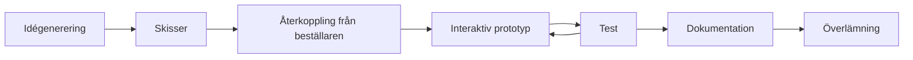

# Kapitel 9: Visuell design, stilguide och överlämning

> **I det här kapitlet lär du dig**
> - grundläggande principer för visuell design
> - vad som skiljer en skiss från en interaktiv prototyp
> - hur du skriver en stilguide
> - hur du dokumenterar och lämnar över ditt arbete

Föreställ dig ett spel där varje meny ser olika ut: en knapp är blå och rund, nästa är röd och kantig, och typsnittet byts mellan sidorna. Inget av det är fel i sig, men helheten känns slarvig och spelaren litar mindre på spelet. Visuell design handlar inte om att göra det fint i efterhand, utan om att göra det begripligt från början.

## Principer för visuell design

| Princip | Betyder | Så här i ett spel |
|---|---|---|
| **Kontrast** | Viktiga saker sticker ut | Starta-knappen har starkast färg |
| **Hierarki** | Det är tydligt vad som är viktigast | Poängen är större än banans namn |
| **Närhet** | Saker som hör ihop ligger nära varandra | Poäng och omgång i samma ruta |
| **Upprepning** | Samma stil används överallt | Alla knappar ser likadana ut |
| **Linjering** | Saker följer samma linjer | Menyvalen står rakt under varandra |
| **Balans** | Vikten fördelas | Tavlan känns inte tung åt ena hållet |

Principerna hänger ihop med användbarheten i [kapitel 8](08-anvandbarhet-och-tillganglighet.md). Hierarki minskar kognitiv belastning, och upprepning gör ett gränssnitt konsekvent.

### Färg och typografi

Välj få färger och ge dem bestämda uppgifter: en bakgrundsfärg, en textfärg, en accentfärg för det viktigaste och kanske en varningsfärg. Välj högst två typsnitt. I VR är typsnitt utan seriffer, med jämn linjetjocklek, oftast lättast att läsa.

Målgruppen styr stilen. Ett pingisspel för barn och ett simulatorspel för proffs kan ha samma funktioner men ska inte se likadana ut.

## Från idé till prototyp

**Idégenerering** handlar om att först ta fram många idéer utan att värdera dem, och sedan välja. En enkel metod är att alla i gruppen skissar i några minuter var för sig och sedan jämför.

**Skisser** ska vara snabba. Handritat och fotograferat räcker. En bra skiss visar var spelaren står, vad hon ser, och hur menyer och poängtavla ser ut.

**Prototyp** är en förenklad version av produkten för att testa en idé.

| Nivå | Vad det är | Bra till |
|---|---|---|
| Låg | Skiss på papper eller gråboxad scen | Att snabbt testa upplägget |
| Medel | Klickbar eller spelbar med enkla former | Att testa flödet |
| Hög | Nära färdig produkt | Att testa detaljer och upplevelse |

I den här kursen är målet en **interaktiv prototyp**: något som spelaren faktiskt kan använda, inte bara titta på. Återkoppling från beställaren ska komma tidigt. Det är billigt att ändra en skiss och dyrt att ändra ett färdigt spel.

## Stilguiden

En **stilguide** är ett dokument som beskriver hur produkten ska se ut och fungera, så att allt blir konsekvent och någon annan kan fortsätta arbetet. Den behöver inte vara lång.

### Genomgånget exempel: stilguide för ett bowlingspel

| Del | Regel |
|---|---|
| Bakgrund på menyer | Mörkblå `#1F4E79` |
| Text | Vit `#FFFFFF`, kontrast 8,66:1 mot bakgrunden |
| Accent | Gul, bara för Starta och Spela igen |
| Typsnitt | Ett typsnitt utan seriffer |
| Rubriker | Minst dubbelt så stora som brödtext |
| Knappar | Rektangulära, samma höjd, ljud och vibration vid tryck |
| Ljud | Ett kort klick för varje knapp, samma överallt |
| Placering | Menyer framför spelaren, ungefär i ögonhöjd |

Stilguiden blir en del av leverabeln. Betygskriterierna handlar om hur många av designens viktiga delar den täcker.

## Dokumentation

Dokumentation är inte något du skriver för att läraren ska bli nöjd, utan något som gör att någon annan, eller du själv om ett halvår, kan förstå arbetet.

Ta med:

- Vad som byggts och varför, med koppling till projektplanen
- Hur projektet startas och byggs
- Vilka assets som används, med källa och licens
- Testresultat och vad du ändrade efter dem
- Kända fel

Efter arbetet ska du också **utvärdera**. Jämför resultatet med framgångskriterierna i din plan. Vad nådde du inte, och varför? Hur förhåller sig gränssnittet till det du lärt dig om HCI? Vad skulle du göra annorlunda?

## Överlämning för implementering

Vid en **överlämning** tar någon annan över det du gjort, till exempel utvecklare som ska bygga färdigt en design. I ett spelprojekt är en bra överlämning ett repo som går att öppna och bygga av någon som inte varit med.

### Git med stora filer

Spelprojekt innehåller stora filer. GitHub har en gräns på 100 MB per fil, och därför används **Git LFS**, som lagrar stora filer separat.

För Unity behöver du dessutom ställa in två saker:

- **Version Control → Mode: Visible Meta Files**
- **Asset Serialization → Mode: Force Text**

`.meta`-filerna ska alltid committas, för utan dem tappar Unity kopplingen mellan filer och komponenter. Två personer ska inte redigera samma scen samtidigt. Bygg gärna funktioner som prefabs, eftersom flera då kan arbeta parallellt.

### Bygga och exportera

| | VR/AR - Projekt | 3D-Spel |
|---|---|---|
| Resultat | `.apk` till Quest | `.exe` till Windows |
| Plattform | Android | Windows |
| Viktiga inställningar | ASTC, IL2CPP, ARM64 | Export-mall för Windows |
| Testa | Hela flödet i headsetet | Hela flödet på en annan dator |

Bygg tidigt och ofta. Det första bygget tar lång tid och avslöjar saker som inte syns i editorn.

## Begrepp

- **Visuell hierarki:** ordning som visar vad som är viktigast.
- **Prototyp:** förenklad version för att testa en idé.
- **Interaktiv prototyp:** prototyp som går att använda.
- **Stilguide:** dokument som beskriver hur produkten ska se ut och fungera.
- **Dokumentation:** beskrivning som gör arbetet begripligt för andra.
- **Överlämning:** att lämna över arbetet till någon annan.
- **Git LFS:** tillägg till Git för stora filer.

## Testa dig själv

1. Vad är skillnaden mellan hierarki och kontrast?
2. Varför är det bra att skissa innan du bygger?
3. Vad ska en stilguide innehålla?
4. Vad är skillnaden mellan en prototyp på låg och hög nivå?
5. Varför ska `.meta`-filer alltid committas?
6. Vad bör en person som tar över ditt projekt hitta i repot?

## Övningar

**Grund.** Ta en skärmbild av en meny du tycker är dålig. Peka ut vilka principer den bryter mot, och skissa en förbättring.

**Vidare.** Skriv en stilguide för ditt eget projekt, med minst sex rader som i exemplet.

**Utmaning.** Be någon utanför projektet klona ditt repo och följa din README för att bygga spelet. Anteckna allt som inte fungerade och förbättra dokumentationen.

## Koppling till projektet

I [VR/AR - Projekt](../projekt/vr-ar/README.md) börjar ni med skisser i planeringsmallen och avslutar med att bygga en `.apk` och putsa grafik, ljud och menyer. I [3D-Spel](../projekt/3d-spel/README.md) exporterar du till `.exe` och använder Git LFS. Betygskriterierna tar också upp stilguide och dokumentation, så fråga läraren hur dessa ska lämnas in.

## Läs mer

- [Git LFS](https://git-lfs.com/)
- [Godot: Exportera till Windows](https://docs.godotengine.org/en/stable/tutorials/export/exporting_for_windows.html)
- [Virtual-Reality](https://github.com/abbjetmus/Virtual-Reality), avsnittet om Git LFS och att arbeta i grupp

[← Föregående](08-anvandbarhet-och-tillganglighet.md) | [Innehåll](../README.md) | [Nästa →](10-vardagsdatorer-etik-och-lagar.md)
